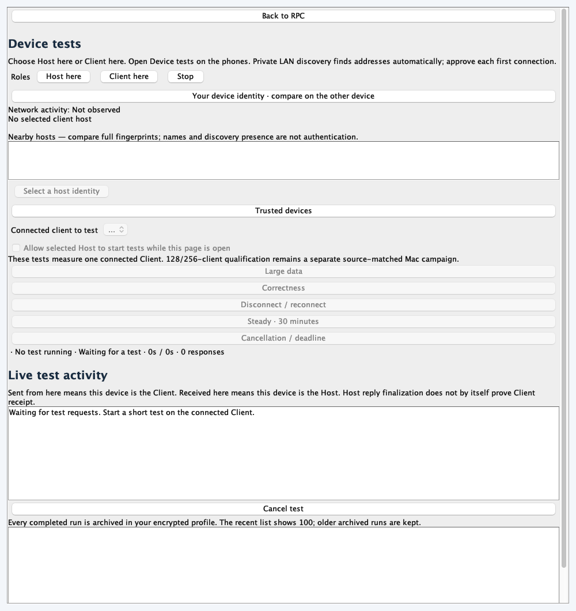
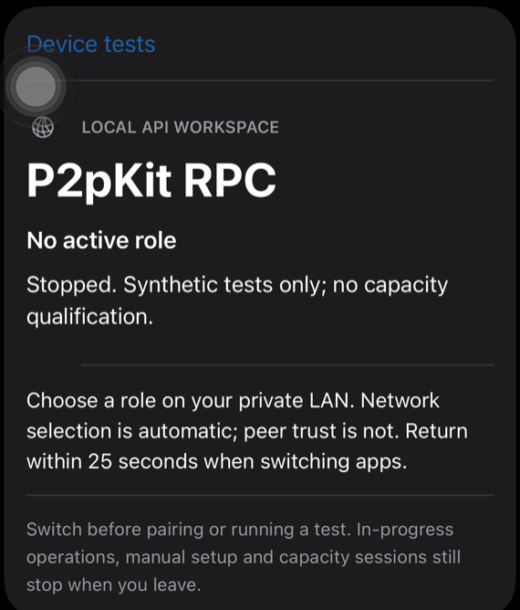

# Manual device tests

The Android, iPhone and Mac RPC samples have a separate **Device tests** screen.
Open it on each device, join the same approved private Wi-Fi, and run the tests
with the buttons. Network discovery supplies addresses; no IP entry is needed.
The exercises send generated test data over the real authenticated and encrypted
RPC connection.

1. Choose **Host here** on one device and **Client here** on another.
2. On the Client, select the nearby Host. Compare fingerprints and approve the
   first connection on the Host. The Host then lists the connected Client.
   The Mac may ask you to unlock its local application profile.
3. Choose a test button on the Client. To start it from the Host, select the
   connected Client and enable **Allow selected Host to start tests** on that
   Client while its Device tests screen is open.
4. Wait for the saved result before starting another test in the two-device
   section. **Cancel this test** ends the selected run; **Cancel all tests** ends
   the active group. **Stop** closes the role and its owned resources.

Start with **Correctness**, **Large data**, **Cancellation / deadline**, then
**Disconnect / reconnect**. Run **Steady · 30 minutes** after the short tests
work. Report a failure immediately with the direction, phase and saved run ID;
there is no need to finish the other tests first. When finished, ask the agent
to collect and analyze the private archives.

For all application directions, exercise Android → Mac, iPhone → Mac,
Mac → Android, iPhone → Android, Mac → iPhone and Android → iPhone. The arrow
means Client sends requests to Host, even when the Host starts a test using
the Client's explicit permission. Choose one phase on one Client at a time.
Keep both phones connected as Clients while Mac is Host, and select each in
turn for Host-started tests.

| Button | Exercise |
| --- | --- |
| Large data | Check exact replies for 64 KiB, 256 KiB and 1 MiB encoded bodies |
| Correctness | Check echo replies, application data and the expected invalid-input error |
| Disconnect / reconnect | Disconnect five times and rediscover the saved Host identity before checking another reply |
| Steady · 30 minutes | Measure thirty minutes separately from initialization, targeting one call every 100 ms |
| Cancellation / deadline | Check a deadline, caller cancellation and a subsequent successful reply |
| Smart · find stable load | Increase request rate and in-flight requests, back off on instability and confirm a stable level |

Keep the apps foreground and unlocked during a test. The iPhone may retain an
ordinary role and active test across one non-renewing app switch of up to25s
on the approved automatic Wi-Fi path. Locking, protected-data loss, network
change, expiry or an earlier iOS background-time expiration still stops it.
This is not unlimited background execution or a physical background qualification. Rediscovery uses the
saved identity and a fresh endpoint, including after an address change. A Wi-Fi
outage that exceeds recovery bounds produces an interrupted or failed result;
it does not silently restart a workload or turn the result into a pass.
Rejoin the approved network and start a new test when the connection is Ready.

**Live test activity** shows requests observed on this device, the procedure,
generated body size when known, reply/error state, elapsed time and execution
evidence. It uses actual RPC observations. A Host handler returning or finalizing
a reply does not by itself prove the Client received it. Source-matched test
registration makes Client-started runs visible on the Host, sends bounded
progress messages about once per second, and delivers the final report.
These progress messages are additional control traffic and are counted
separately from workload responses. A missing final report stays unconfirmed;
it is not converted into a passed result on the Host.

Every completed or failed test is saved as a separate private archive record;
older records are not automatically deleted. The recent-results list keeps
100 runs in memory. Android and iPhone use application-private
`rpc-test-archive` directories; Mac keeps encrypted records and a paged index
inside its existing protected profile. Archive-write failure is displayed and
pending records are retained; a full pending queue refuses new tests instead
of discarding an old result. Stop and changing roles keep these archives.
Uninstalling an app or deleting its profile/data can still remove its files.

Reports include Client → Host platform direction, start/end times, which side
initiated the test, run ID, phase, source, Pair/Multi mode and optional group ID,
actual client count, initialization and measured durations, correct responses,
latency percentiles, missed schedules, deliberate disconnect/deadline outcomes
and available sampled resources. They retain bounded recent request observations;
the live panel can miss intermediate states and is not a complete packet trace.
Old reports without endpoint metadata keep **Unknown** instead of guessing a
direction or date. Missing measurements remain unavailable.
Serious or critical thermal observations interrupt the exercise. Charging
observations do not establish battery discharge.

## Multi-device tests and monitoring

Open **Multi-device tests** on the Host and every participating Client. Pair each
Client with that Host and enable its test permission. On the Host, select the
connected Clients and press one phase button. Up to16 distinct trusted Clients
can run concurrently, within the unchanged Host admission limits. A Client may
also start its own run in this section. Each Client still has one active local
run; the Host keeps separate progress, resource windows, cancellation and saved
output for each peer. Host-started groups share a group ID. Finishing/cancelling
one peer does not finish/cancel the others.

The monitor shows current local CPU interval, memory/thread kinds, charging and
available battery/thermal observations. Per-run Host telemetry is sampled and
sent separately from workload replies. Host resource summaries and per-stage
resource snapshots are cumulative since that run began; overlapping runs share
one process, so their resource totals must not be added. CPU is percent of one
core, Android temperature is a battery sensor, and iOS thermal categories are
coarse. Mac memory/threads are JVM heap/JVM thread measurements. Missing native
RSS, native threads, current or temperature values are not invented.

**Clear displayed logs** hides the current live observations and recent results
without changing saved records. **Show saved results** restores the recent list.
Expand/select one result to inspect its details. **Delete this output…** requires
explicit confirmation, blocks new test admission while deleting, and removes only
that run on this device. A durable deletion marker prevents an old recent index
from restoring it after interruption. Other devices retain their own copies.
Records are bounded at64KiB and the recent index holds100 runs; immutable older
records remain in the private archive. No automatic purge is introduced.

## Smart Test

Press **Smart · find stable load**; no RPS configuration is needed. The default
workload uses exact1KiB encoded echo requests. It starts at1 request/s and one
worker, grows the request rate and in-flight limit using observed latency, brackets
instability, backs off and confirms a candidate on a fresh stage. A failed
confirmation reduces pressure and measures again. Stages default to10s.

Decisions use observed correct throughput, p50/p95/p99, errors/timeouts, missed
schedules and available Client/Host process and thermal measurements. Growth
stops on throughput plateau with worsening latency/scheduling, latency/error
thresholds or immediate safety failures. OS memory-pressure warnings, an
unresponsive/disconnected Host, response corruption, serious/critical thermal
state, Android battery temperature≥45°C and memory/thread safety limits interrupt
the run. Missing/stale Host telemetry cannot certify Host resource safety.

Default safety budgets are600s,24 stages,64 workers,5,000 target requests/s,
512MiB process memory and512 threads. p95/p99 limits default to1s/2s; errors and
missed schedules to1%/10%. The optional safety panel changes latency, memory and
time budgets. These ceilings prevent unbounded work and are **not discovered
capacity**. Reaching a ceiling produces a confirmed lower bound only. A time or
stage budget without fresh confirmation does not produce a stable claim.

Each report retains stage decisions, failures/timeouts, latencies, observed
throughput, highest freshly confirmed target/throughput, measured peak in-flight
concurrency, configured worker limit and stop reason. Local workers are cancelled
or joined before saving. The existing application connection stays open for the
next test; use Stop to close the role. No new connections are created by this
Smart driver. It cannot establish independent-client connection capacity.

Smart results describe the **measured Client-to-Host path**. A generator may
become the bottleneck; missed scheduling and its resources are reported. In Multi
mode, each Client adapts independently under the overlapping workload; non-aligned
stable maxima must not be summed into a Host capacity claim. Independent Mac client
cohorts and coordinated aggregate capacity search remain outside these buttons.

These buttons exercise **one connected Client per run**. A Host can select each
connected phone in turn, allowing Mac Host with both phone Clients and reciprocal
Android/iPhone roles. These application exercises do not establish 128/256-client
capacity, simultaneous 255 Mac clients plus a phone, socket backpressure, fairness,
revocation coverage or battery-discharge qualification. Use the
[maintained physical campaign](mac-mobile-continuation.md) for that scope.
Both endpoints must use matching source; a mismatch produces a failed result.
Authentication, encryption and first-connection approval remain required.

If the Mac's existing profile passphrase is unavailable, run its prepared
`run-desktop.py --new-test-profile` launcher. This creates a separate private
test profile. Choose a new strong passphrase of 12–128 characters in the app;
the existing profile, identity and approvals remain intact. Each invocation
with this flag creates another profile. The normal launcher keeps its existing
default profile.

## Screenshots

The Mac image is an idle UI render fixture from prepared source `840a09da`,
including the Live test activity panel and permanent-archive explanation. The iPhone
image shows source `840a09da` installed on the physical iPhone, with its Device
tests entry and no active role.
Neither image is workload evidence. Android's protected screen refused automated
capture; its private UI observation verified the page and all five buttons.

